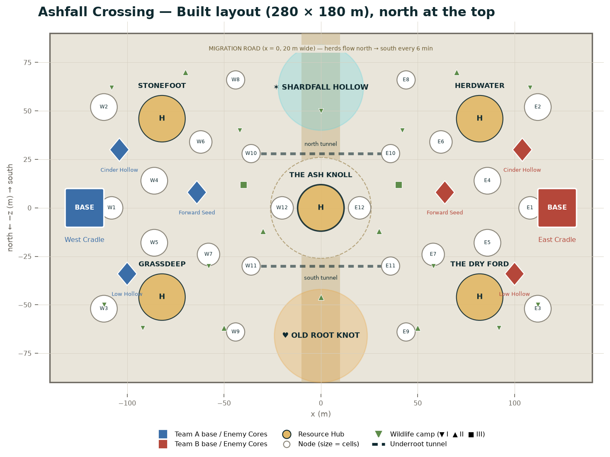

# Part 8 — Map Rules and Ashfall Crossing

## 8.1 Rules every 4v4 map follows

| Rule | Value | Source |
|---|---|---|
| Playable size | About 320 × 320 m | Spec (`gdd/16`) |
| Nodes | About 30, ~110 cells (1–6 cells per node) | Spec |
| Resource Hubs | 5: two near each base, one central | Spec |
| Enemy Core sites | 3 per team, in its own half | Spec |
| Bases | 1 per team, a birth-node cluster | Spec |
| Symmetry | Neither base may have better routes, distances or resources | Spec |
| Crater zone and Heartwood grove | On the two flanks, each equidistant from both bases | Spec |
| Memory sites | 2–3 per map | Spec |
| Return trip | ≤ 20 s from any Hub to base | Spec |
| Tension regions | 5 per map, one per Hub | Spec (`spec/05` §8) |

### Symmetry: mirror, not rotation

`gdd/16` asks for rotational symmetry. On a map whose crater zone is on one flank and
whose grove is on the other, a 180° rotation would carry the crater onto the grove's
side, so the two zones could not both be equidistant from both bases. **Proposal:** use
**mirror symmetry across the centre line between the bases** (x = 0 for an east–west
map). The flank zones sit on that line, so each is exactly equidistant from both bases.
The playable build already does this (Built: `game/src/sim/map.ts`). Maps without
flank zones on the centre line (The Skull Basin) may use rotation.

### Metrics for greybox (Proposal)

| Metric | Value | Why |
|---|---|---|
| Base speed | 5.0 m/s; sprint 6.5 m/s out of combat after 4 s | Spec |
| Base → nearest own Hub | 50–70 m path (10–14 s) | Early Hub fights near home |
| Base → central Hub | ≤ 130 m path (≤ 20 s at sprint) | Return rule; the central Hub also allows field conversion |
| Base → own Enemy Cores | 25–70 m | Defensible in time |
| Base → enemy base | 240–280 m path | ~45–55 s at sprint, so a push is a commitment |
| Max open sightline at ground level | 120 m | Longer than Spire Lance (50 m) but short enough that cover matters |
| Cover spacing on open ground | A Stage 2-hiding object (≥ 4 m tall) every 25–35 m | Room to move between fights |
| Chokepoints | ≥ 8 m wide; ≤ 2 per route between bases | No single-file traps |
| Elevation | 3 layers: low ground, rises (2–6 m), high points (8–15 m) | Every lineage has a place |
| Ramps | ≤ 30° slope for walking; steeper is a cliff | Built: slope mask stops territory veins on cliffs |
| Fall damage | None; dropping a level costs time only | `gdd/42` vertical rules |

### Every map document includes

1. Identity and the fight style it rewards.
2. A layout with coordinates for bases, Hubs, Cores, nodes, flank zones and routes.
3. The signature mechanic with exact timings and telegraphs.
4. Wildlife camps with positions and respawn.
5. Apex spawn and route.
6. Memory sites and callout names.
7. Weather pool, time-of-day moods and lighting.
8. Audio zones.
9. Lineages it favours, and a balance check.
10. A greybox checklist.

---

## 8.2 Ashfall Crossing (launch map 1)

**Regions:** Ashen Steppe above, Underroot below. **Identity:** open teamfights across
grassland, flanks through tunnels, and the Grey Migration splitting the map in two.
**Favours:** Bonespire (long sightlines), Thornrunner (tunnel flanks), the Commit pair (open teamfights).
**Teaches:** timing (the Migration), open fights, the tunnels.

### Status

| Version | Size | What exists |
|---|---|---|
| **Built** (vertical slice) | 280 × 180 m (x −140…140, z −90…90) | Heightfield, 240-cell grid (20 × 12 cells of 14 × 15 m), Voronoi nodes, 5 Hubs, 6 Enemy Cores, 20 wildlife camps, Shardfall Hollow crater, Old Root Knot hill, mirror symmetry |
| **Production** (Proposal) | 320 × 240 m | The same layout, with the flank zones pushed out to become real places (below) and the Migration road and tunnels added |

The coordinates below are the **Built** layout (they are the greybox reference). The
production version keeps every x position and scales z by 1.33 for the flanks only
(|z| > 50), so the core fighting space stays as tested.

### Layout overview

*Diagram generated by `design-bible/tools/draw_maps.py` from the coordinates in this part.*

### Bases, Hubs and Enemy Cores (Built coordinates)

| Structure | West team | East team (mirror) | Callout name |
|---|---|---|---|
| Base | (−122, 0) | (122, 0) | West Cradle / East Cradle (the Clutch when Blightborn) |
| North Hub | (−82, −46) | (82, −46) | **Stonefoot** (W), **Herdwater** (E) |
| South Hub | (−82, 46) | (82, 46) | **Grassdeep** (W), **The Dry Ford** (E) |
| Central Hub | (0, 0), shared | — | **The Ash Knoll** |
| Enemy Core, north | (−104, −30) | (104, −30) | **Cinder Hollow** |
| Enemy Core, south | (−100, 34) | (100, 34) | **Low Hollow** |
| Enemy Core, forward | (−64, −8) | (64, −8) | **Forward Seed** |

`gdd/16` gives the east Hubs their own names (Herdwater by a watering hole, The Dry Ford
at a dry river crossing); because the map is mirrored, each east Hub's set dressing
mirrors its west twin's layout with a different landmark, so callouts stay unique.

### Distances (Built layout, straight line)

| From → to | Distance | Walk (5 m/s) | Sprint (6.5 m/s) |
|---|---|---|---|
| Base → own north or south Hub | 61 m | 12 s | 9 s |
| Base → The Ash Knoll | 122 m | 24 s | 19 s |
| Base → Forward Seed | 59 m | 12 s | 9 s |
| Base → Cinder Hollow / Low Hollow | 35 m / 40 m | 7–8 s | 6 s |
| Own north Hub → enemy north Hub | 164 m | 33 s | 25 s |
| Ash Knoll → Shardfall Hollow centre | 62 m | 12 s | 10 s |
| Ash Knoll → Old Root Knot centre | 66 m | 13 s | 10 s |
| Base → enemy base | 244 m | 49 s | 38 s |

All Hubs meet the 20 s return rule at sprint speed. The Ash Knoll is the edge case
(19 s), which is intended: it's the riskiest Hub to convert from, so field conversion there matters.

### Node list (production layout, Proposal)

The Built map generates nodes automatically (Voronoi from mirrored seeds, Hubs take their
6 nearest cells). For production, the nodes are hand-placed and named. West side listed;
each east node mirrors it at (−x, z) with the same name and an E prefix.

| Node | Position | Cells | Terrain | Notes |
|---|---|---|---|---|
| W1 Cradle Gate | (−108, 0) | 3 | Flat ash in front of the base | Base edge node: Vulnerable in Phase 4 |
| W2 North Stones | (−112, −52) | 4 | Two Standing Stones | Base edge node; Stones hide a Stage 2 |
| W3 South Grass | (−112, 52) | 4 | Tall Ashgrass | Base edge node; Glimmerfox camp nearby |
| W4 Ash Flat | (−86, −14) | 4 | Open, flat | Links the base to the Forward Seed |
| W5 Grassdeep Field | (−86, 18) | 4 | Grass with scattered boulders | Between Grassdeep and the base |
| W6 Watch Rock | (−62, −34) | 3 | An 8 m rock with a walkable top | **Bonespire perch**: sightline to the Ash Knoll |
| W7 Herd Track | (−58, 24) | 3 | A worn trench (the Herdpath) | Spurlark camp; cover from the trench walls |
| W8 Ridge Lip | (−44, −66) | 2 | Rim of Shardfall Hollow | Overlooks the crater |
| W9 Root Edge | (−44, 64) | 2 | Roots breaking the surface | Approach to the Old Root Knot |
| W10 North Tunnel Mouth | (−36, −28) | 2 | A root-ringed hole | Entrance to the north tunnel |
| W11 South Tunnel Mouth | (−36, 30) | 2 | A root-ringed hole | Entrance to the south tunnel |
| W12 Road Bank | (−20, 0) | 3 | The west bank of the Migration road | Closest node to the Ash Knoll; flooded by herds during the Migration |
| Shardfall Hollow | (0, −62) | 5 | Crater floor with Starshard veins | Flank zone; Blight 2× faster, roots 50% slower |
| Old Root Knot | (0, 66) | 5 | Twisted root-hill | Flank zone; roots 2× faster, Blight 50% slower |
| Hubs (5) | See above | 6 each | — | — |

**Totals:** 24 side nodes + 2 flank nodes + 5 Hubs = **31 nodes**; 72 + 10 + 30 = **112 cells**.

### Terrain and height (Built)

| Feature | Where | Height |
|---|---|---|
| Rolling steppe | Everywhere | ±3.5 m noise |
| North and south ridges | z beyond ±70 | Rise steeply (up to ~16 m); keep play inside |
| East and west edges | x beyond ±128 | Rise behind the bases |
| The Ash Knoll | Centre, radius 26 m | +4.5 m |
| Shardfall Hollow | (0, −62), radius 22 m | −7 m bowl with a +5 m rim |
| Old Root Knot | (0, 66) | A raised, twisted root-hill |

**Obstacles (Built):** ~140 mirrored boulders (r 1.2–3.8 m) kept 18 m clear of every base,
Hub and Core; meteor shards inside the crater (r 1.4 m), roots on the knot. Creature
navigation uses a 2 m A* grid; the camera collides with rocks.

### The Grey Migration (signature mechanic, Proposal timings on Spec rule)

| Rule | Value |
|---|---|
| Timing | Every **6 min** for **60 s** (`gdd/16`): at 6:00, 12:00, 18:00, 24:00 (Short match: every 3 min for 30 s) |
| Warning | **20 s** before: a dust wall rises on the north horizon, the ground hums, Ember Moths and Gravel Skinks flee south; the HUD shows a 20 s timer and highlights the road |
| The road | A band **20 m wide** along x = 0, from the north ridge to the south ridge, except the Ash Knoll itself |
| During | Herds flow north → south along the road at 7 m/s. Anyone on the road takes **40 damage/s** and is pushed 6 m/s south-east or south-west off the road (Stage 3 Titans: pushed 3 m/s). Ground-targeted abilities can't be placed on the road |
| The Knoll | The herds split around the Ash Knoll, which becomes an **island**: whoever is on it is cut off for 60 s, reachable only through the **Knoll Shaft** from the tunnels |
| Crossing | Only through the Underroot tunnels |
| After | The herds' dust settles; the road shows trampled grass for 30 s (cosmetic); Ash Vultures arrive |

**Herd composition (cosmetic, not targetable):** Mossback-like grazers, Rimeback-like
stags and Stiltwalkers, rendered as an instanced crowd of ~150 animals using 6 LOD'd
models with vertex animation. They're scenery during the crossing: they can't be attacked
and drop nothing, so the Migration never becomes a farm.

**Phase 3 onward:** the **Greyback Colossus** walks with the herd (it spawns at the north
end at the start of a Migration and continues at 2.5 m/s after the herd has passed, so it
crosses the map in ~70 s and then turns back north along the same road). Its back is a
moving 3-cell node. It's the map's Tier IV.

### The Underroot tunnels (Proposal)

| Tunnel | From | To | Length | Width × height | Notes |
|---|---|---|---|---|---|
| North tunnel | W10 (−36, −28) | E10 (36, −28) | ~80 m with bends | 7 m × 11 m | Two Lantern Lizards on the walls; one side alcove per half |
| South tunnel | W11 (−36, 30) | E11 (36, 30) | ~80 m | 7 m × 11 m | Two Lantern Lizards; a Burrowtusk den in a side chamber |
| Knoll Chamber | Under the Ash Knoll, joining both tunnels by short passages | — | 24 m across | 11 m high | Lit by nerve-roots; pulses every 20 s (cosmetic) |
| Knoll Shaft | Knoll Chamber → top of the Ash Knoll | — | 10 m vertical | 6 m wide | Climbed on Bonevine at 2.5 m/s; one-way down is a drop (no damage) |

**Rules:** tunnels hold no nodes (territory is a surface system). Sight is 18 m inside.
Sound carries ×1.5 (footsteps heard farther). The surface minimap shows tunnels as a
dashed overlay and players in them only when revealed.

### Flank zones

**Shardfall Hollow (north, crater zone).** A field of fallen meteor shards in a 22 m bowl.
- Blight spreads 2× faster, roots 50% slower (Spec).
- **Starshard veins:** 3 veins (500 Health each, Proposal) in the crater floor; breaking one
  releases **60 cores** in a burst (Proposal; Spec says "large core caches"). They regrow every 4 min.
- **Shard storms** (hazard, Proposal): every 4 min from Phase 2, a 20 s storm inside the bowl;
  12 damage/s to anyone not under a shard overhang; sight 15 m. Telegraphed 10 s ahead by glittering haze.
- Memory site: *The Sky Breaks*, an impact scar at the bowl's lowest point.
- Built: 9 mirrored shard obstacles inside the bowl.

**Old Root Knot (south, Heartwood grove).** A twisted root-hill with SAP springs.
- Roots spread 2× faster, Blight 50% slower (Spec).
- **SAP springs:** 2 springs (Proposal); standing in one for 3 s gives your team **20 SAP**; each refills in 60 s.
- **Grasping ground** (hazard, Proposal): patches of moving roots; anyone standing still on one for
  1.5 s is rooted 0.8 s (2 s cooldown per player). Visible as twitching roots.
- The Heartwood Elk can appear here (rare).

### Wildlife camps (Built)

West camps listed; each has a mirrored twin at (−x, z). Two extra camps sit on the centre line.

| Camp | West position | Species | Tier | Notes |
|---|---|---|---|---|
| 1 | (−108, −62) | Gravel Skink | I | Behind North Stones |
| 2 | (−92, 62) | Gravel Skink | I | Behind South Grass |
| 3 | (−58, 30) | Spurlark | I | On the Herd Track |
| 4 | (−42, −40) | Glimmerfox | I | Near Watch Rock |
| 5 | (−70, −70) | Ashfang pack | II | Below the north ridge |
| 6 | (−50, 62) | Mossback Grazer herd | II | Toward the Old Root Knot |
| 7 | (−30, 12) | Clashhorn Beetles | II | Near the Road Bank |
| 8 | (−112, 50) | Glimmerfox | I | Base flank |
| 9 | (−40, −12) | Stonehide Ox | III | Between the Forward Seed and the Knoll |
| Centre | (0, −50) | Gravel Skink | I | Crater approach |
| Centre | (0, 46) | Mossback Grazer herd | II | Grove approach |

**Placement check.** The Built camps give Tier I 11 groups · Tier II 7 · Tier III 2,
which is **below** the Spec range for a standard map (Tier I 16–20 · II 10–12 · III 4–6).

**Production additions (Proposal) to reach the range:**

| Addition | Per side | Tier |
|---|---|---|
| **Strays**, near W4 and W5 | 2 groups | I |
| **Ember Moths** over the Ashgrass (dusk and night) | 1 swarm | I |
| **Lantern Lizards** in the tunnels (shared, 4 total) | — | I |
| **Stiltwalker** looping the north plain (cover for crossing open ground) | 1 | II |
| A second **Ashfang** pack on the south plain, (−66, 70) | 1 | II |
| A second **Stonehide Ox**, (−64, 56) | 1 | III |

**Totals with additions:** Tier I 17 groups · Tier II 11 · Tier III 4 · Tier IV 1 (Greyback Colossus, Phase 3).

### Memory sites

| Memory | Where | Trigger |
|---|---|---|
| *The Hunt Passes* | A rise on the north ridge, (−20, −80) and mirrored | Stand there at dusk; the Hunt That Never Ended can be glimpsed far off |
| *The Sky Breaks* | Shardfall Hollow's lowest point (0, −62) | Touch the impact scar |

### Horizon landmarks

| Direction | What players see |
|---|---|
| North | The Standing Stones in a line; Shardfall Hollow's glitter; the Fall-line in the sky |
| West | The Vertebrae, far off |
| South | Greymother on the southern horizon (rare) |
| Beside the road | **The Scarred Runner** (Old One) walks beside every Migration, beyond the north ridge |

### Weather, light and time of day

| | Value |
|---|---|
| Weather pool | Clear, Ashfall, Breathing Night (Spec) |
| Dawn | Mist over the grass |
| Day | Pale and open |
| Dusk | Gold light; long shadows of the Stones; Ember Moths rise |
| Night | The Fall-line overhead; the Migration's dust glowing |
| Built lighting | Sky, fog, shadows, environment map; grey-gold haze |

### Audio zones (Proposal)

| Zone | Bed | Spot sounds |
|---|---|---|
| Open steppe | Wind through grass, distant herds | Skink rattles, Spurlark trills, Ashfang howls at night |
| The Ash Knoll | Wind stronger, ash hissing | Hub sound (roots groaning / crystal singing) |
| Shardfall Hollow | Glass chiming in the wind, a low whisper | Shard storm hiss; vein cracks |
| Old Root Knot | Creaking roots, a slow heartbeat | SAP spring bubbling |
| Tunnels | Dripping water, nerve hum | Lantern Lizard ticks; echoing footsteps |
| Migration | A rising rumble 20 s ahead; then thunder of hooves | Bellows, dust |

### Greybox checklist

- [x] Bases, Hubs, Cores at mirrored positions (Built)
- [x] Crater and grove on the centre line (Built)
- [x] Wildlife camps mirrored (Built)
- [ ] Migration road (20 m band) with the Knoll island
- [ ] Two tunnels, Knoll Chamber and Knoll Shaft
- [ ] Hand-placed named nodes (replacing Voronoi)
- [ ] Starshard veins, SAP springs, shard storms, grasping ground
- [ ] Watch Rock perches (8 m, walkable tops)
- [ ] Greyback Colossus route and back-node
- [ ] Production flank expansion (z ±120)
