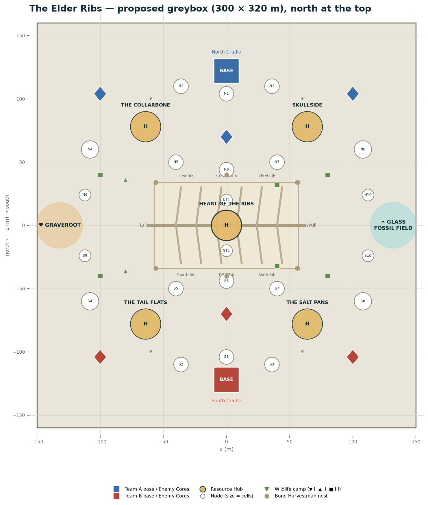
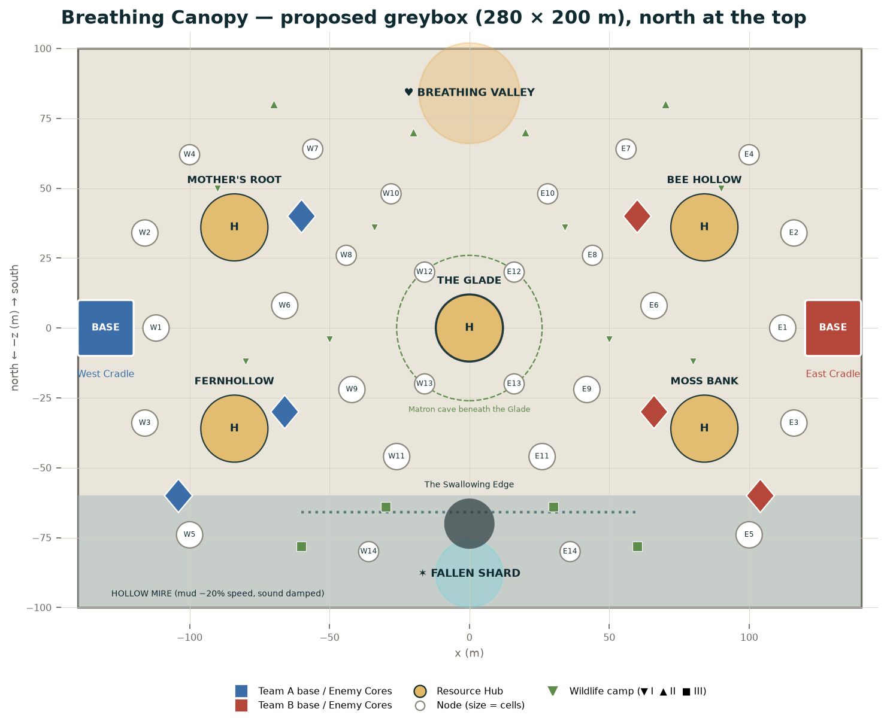

# Part 9 — The Elder Ribs and Breathing Canopy

Both launch maps follow the rules in §8.1. Identity, mechanics, wildlife, Memory sites,
callouts and weather pools are **Spec** (`gdd/16`). Coordinates, node lists, dimensions
and timings are **Proposal** for greybox. Neither map is built yet.

---

## 9.1 The Elder Ribs (launch map 2)

**Region:** Bone Flats. **Identity:** siege play around a central fortress made of the
Rememberer's fossil ribcage. **Fight style:** siege and defence; chokepoints.
**Favours:** Bonespire (rib-top vantage), Titan and Brawler (holding the entrances),
anyone good at weak points. **Teaches:** sieges, chokepoints, weak points.

### Orientation and symmetry

Bases are **north and south**. The mirror line is **z = 0**, running east–west along the
ribcage's spine. The flank zones sit on that line: **Graveroot** (Heartwood grove) at the
far west, the **Glass Fossil Field** (crater zone) at the far east.

*Diagram generated by `design-bible/tools/draw_maps.py` from the coordinates in this part.*

### Structures

| Structure | North team | South team (mirror) | Callout |
|---|---|---|---|
| Base | (0, −122) | (0, 122) | North Cradle / South Cradle |
| West Hub | (−64, −78) | (−64, 78) | **The Collarbone** (N) · **The Tail Flats** (S) |
| East Hub | (64, −78) | (64, 78) | **Skullside** (N) · **The Salt Pans** (S) |
| Central Hub | (0, 0) inside the ribcage | — | **The Heart of the Ribs** |
| Enemy Core, west | (−100, −104) | (−100, 104) | North-West / South-West Core |
| Enemy Core, east | (100, −104) | (100, 104) | North-East / South-East Core |
| Enemy Core, forward | (0, −70) | (0, 70) | Spine Core |

**Distances:** base → own Hubs 78 m (16 s walk, 12 s sprint); base → The Heart of the Ribs 122 m
(19 s sprint); base → forward Core 52 m; base → enemy base 244 m.

### The ribcage (centrepiece)

| Element | Value |
|---|---|
| Footprint | 110 m (east–west, along the spine) × 64 m (north–south) |
| Spine | A fossil backbone along z = 0, 6 m high, walkable on top from the tail end (west) |
| Ribs | 6 ribs per side arch from the spine to the ground; each 40–60 m long, 4 m thick, peaking 18 m high |
| Entrances | The gaps between ribs that reach the ground: **3 on the north side, 3 on the south** (First–Third Rib north, Fourth–Sixth Rib south), each **10–14 m wide**, 12 m tall |
| Floor | Salt-crusted, 80 × 44 m inside; the Hub pool sits in the centre |
| Rib tops | Reached by **Bonevine** at 4 points (two per side, outside the cage); climbing 2.5 m/s; each rib top is a 3 m-wide walkway |
| Vantage | Rib tops overlook the whole map; the best Bonespire perch in the launch set. They're exposed from both sides |
| Skull end (east) | The fossil skull, 25 m tall, half-buried; its eye socket is a cave with the *Not the Titan* Memory |
| Tail end (west) | Vertebrae trailing into the ground toward Graveroot |
| Cover inside | Fallen rib fragments (3–5 m tall) in a ring around the Hub, 15 m from the pool |

**Fight logic.** Holding the Heart of the Ribs means holding up to six entrances. A team
inside can defend with Titans and Brawlers at the gaps while a Bonespire covers from the
rib tops. Attackers split across entrances, or take the rib tops first. Each side's three
entrances face its own base, so neither team starts closer to more entrances.

### Node list (north side; south mirrors at (x, −z))

| Node | Position | Cells | Terrain | Notes |
|---|---|---|---|---|
| N1 North Gate | (0, −104) | 3 | Salt flat in front of the base | Base edge node |
| N2 West Bones | (−36, −110) | 3 | Bone field (slows 10%) | Base edge node |
| N3 East Bones | (36, −110) | 3 | Bone field | Base edge node |
| N4 Collar Field | (−108, −60) | 4 | Open salt | Near the Collarbone |
| N5 First Approach | (−40, −50) | 3 | Fossil cover | Leads to First Rib |
| N6 Spine Approach | (0, −44) | 3 | Open, exposed | Leads to Second Rib; Spine Core nearby |
| N7 Third Approach | (40, −50) | 3 | Fossil cover | Leads to Third Rib |
| N8 Skull Field | (108, −60) | 4 | Salt pans with Harvestman nests | Near Skullside |
| N9 Graveroot Edge | (−112, −24) | 2 | Roots wrapping bones | Grove approach |
| N10 Glass Edge | (112, −24) | 2 | Glazed fossils | Crater approach |
| N11 Rib Top North | On the northern rib tops | 2 | Bone walkway | A high node: capture from the walkway |
| Graveroot | (−132, 0) | 5 | Heartwood grove | Roots ×2, Blight ×0.5; SAP springs; grasping ground |
| Glass Fossil Field | (132, 0) | 5 | Crater zone | Blight ×2, roots ×0.5; Starshard veins inside glass fossils |
| Hubs (5) | — | 6 each | — | — |

**Totals:** 22 side nodes + 2 flank + 5 Hubs = **29 nodes**, 64 + 10 + 30 = **104 cells**.

### Signature mechanics

**Bone nests (Spec rule, Proposal placement).** Six Bone Harvestman nests around the outside of
the ribcage, three per side, mirrored: (−56, ±34), (0, ±40), (56, ±34). Each fills with 1 core
per 3 s up to 80 (4 min). Both teams have a reason to patrol the outside of the Ribs.
Harvestman bone-clicking is a constant background sound near the cage.

**Salt glare (Proposal).** In Clear weather at "noon" (the middle third of the day cycle),
looking within 30° of the sun's direction across the salt reduces sight to 22 m and washes out
colours; team outlines stay at full strength. Both sides face the sun equally because the sun
path runs east–west along the mirror line.

### Wildlife (Spec list, Proposal positions; north side, mirrored)

| Species | Tier | Positions | Notes |
|---|---|---|---|
| Bone Harvestman | II | 3 nests (above) | Core caches |
| Marrowhound pair | II | (−80, −36) | Scavenge every fight |
| Bonewright + 3 totems | III | (−100, −40) | Buffs nearby wildlife |
| Trundleback | III | Loops (−30…30, −30) | Climbable high ground; underside weak point |
| Siege Beetle | III | (80, −40) | Lure it into enemy Cores |
| Marrow Mantis | III | Among fossils at (40, −32) | Ambush from bones |
| Strays | I | 2 groups at (±60, −100) | Wild evolution |
| Gravel Skinks | I | (±24, −90), 2 groups | Early income |

**Apex:** none native (Spec). Patron events wake the **Old Tall** (Planet Pulse) or a
**Blighted Wyrm** (Murmur Surge). The Old Tall walks Hub to Hub: Collarbone → Heart → Salt Pans (or mirrored).

### Memory sites

| Memory | Where |
|---|---|
| *The Rememberer's Vigil* | Inside the ribcage, at the base of the spine (−50, 0) |
| *The Hushed* | A glass fossil in the Glass Fossil Field, showing the Murmur's first copies |
| *Not the Titan* | Inside the skull's eye socket (east end) |

### Horizon and mood

| | Value |
|---|---|
| Horizon | The Skull Basin's rim; the Cairnback on the western skyline; the Bone-Keeper far out on the flats |
| Weather pool | Clear (salt glare at noon), Shard Storm, Breathing Night (Spec) |
| Dawn | Salt glittering |
| Day | Harsh glare |
| Dusk | The Ribs glowing orange |
| Night | Moonlight through the ribs, striped shadows across the floor |
| Audio | Wind whistling through the ribs (a different note per gap, so a player can tell which entrance they're near by ear) |

---

## 9.2 Breathing Canopy (launch map 3)

**Regions:** Rootwilds and Hollow Mire. **Identity:** a tight ambush map where the forest
itself changes the sightlines. **Fight style:** ambush and skirmish; many small nodes.
**Favours:** Verdant and Hollow (nodes and stealth), Thornrunner (ambush).
**Teaches:** territory, stealth, reading the world (cranes, the canopy cycle).

### Orientation

Bases **west and east**, mirror line **x = 0**. **The Breathing Valley** (Heartwood grove) is
north at (0, −84); **The Fallen Shard** (crater zone) is south, sunk in the mire at (0, 88).

*Diagram generated by `design-bible/tools/draw_maps.py` from the coordinates in this part.*

### Structures

| Structure | West team | East team (mirror) | Callout |
|---|---|---|---|
| Base | (−130, 0) at the foot of a great breathing oak | (130, 0) | West / East Cradle |
| North Hub | (−84, −36) | (84, −36) | **Mother's Root** (W) · **Bee Hollow** (E) |
| South Hub | (−84, 36) | (84, 36) | **Fernhollow** (W) · **Moss Bank** (E) |
| Central Hub | (0, 0) | — | **The Glade** |
| Enemy Core, north | (−60, −40) | (60, −40) | Oak Core |
| Enemy Core, south | (−66, 30) | (66, 30) | Fern Core |
| Enemy Core, mire | (−104, 60) | (104, 60) | Mire Core |
| Mire route | (−60…60, 66) | — | **The Swallowing Edge** |

**Distances:** base → own Hubs 60 m; base → The Glade 130 m (20 s sprint, the limit);
base → enemy base 260 m. Paths wind between trunks, so real path lengths are ~15% longer
than straight lines; check the Glade return in greybox and move the bases 6 m inward if needed.

### The breathing canopy (signature mechanic)

| Rule | Value |
|---|---|
| Cycle | **90 s** (Spec) |
| Rise | The canopy lifts over 10 s, stays **open for 30 s** (Spec: rises for 30 s), then falls over 10 s |
| Closed | 40 s of dense shade |
| Open state | Normal sight (30 m; Stage 3 40 m); light floods in; Bonespire ranges usable |
| Closed state (Proposal) | Sight under the canopy **18 m**; minimap reveals from sight shrink to match; footsteps ×0.8 range |
| Telegraph | A deep inhale sound 5 s before rising; an exhale and a mist puff 5 s before falling; the HUD shows a breathing ring |
| Clearings | The Glade and the Hubs are open sky: sight never drops there |
| Sync | The whole map breathes together; both teams get the same cycle |

**Fight logic.** Open phases favour ranged pick-offs and rotations; closed phases
favour ambushes and stealth captures. Good teams time pushes to the breath.

### Node list (west side; east mirrors at (−x, z))

Many small nodes (Spec), so territory changes hands constantly.

| Node | Position | Cells | Terrain |
|---|---|---|---|
| W1 Oak Gate | (−112, 0) | 2 | Roots of the base oak (base edge) |
| W2 North Ferns | (−116, −34) | 2 | Fern dell (base edge) |
| W3 South Ferns | (−116, 34) | 2 | Fern dell (base edge) |
| W4 Lantern Trees | (−100, −62) | 1 | Lanternmoss trees |
| W5 Mire Bank | (−100, 74) | 2 | Mire edge (mud −20% speed) |
| W6 Bramble Run | (−66, −8) | 2 | Dense undergrowth |
| W7 Old Log | (−56, −64) | 1 | A fallen giant trunk (walk along the top) |
| W8 Deer Path | (−44, −26) | 1 | Narrow trail |
| W9 Sap Spring | (−42, 22) | 2 | A small SAP spring (Sapdrinker nest) |
| W10 Aphid Bush | (−28, −48) | 1 | Sapback Aphid herd |
| W11 Web Hollow | (−26, 46) | 2 | Weavemother's web (contested node) |
| W12 Glade Edge North | (−16, −20) | 1 | Edge of the clearing |
| W13 Glade Edge South | (−16, 20) | 1 | Edge of the clearing |
| W14 Reed Bank | (−36, 80) | 1 | Whisperreed (Hush Cicadas) |
| The Breathing Valley | (0, −84) | 4 | Heartwood grove; Heartbloom grows here |
| The Fallen Shard | (0, 88) | 4 | Crater zone in the mire; Glasscap fungus |
| Hubs (5) | — | 6 each | — |

**Totals:** 28 side nodes + 2 flank + 5 Hubs = **35 nodes**, 42 + 8 + 30 = **80 cells**. Fewer cells
than the 110 target is intended: smaller nodes flip faster. Verdant capture (2 s) dominates here.

### The Hollow Mire (south)

| Rule | Value |
|---|---|
| Mud | −20% speed (Spec) |
| Sound | Damped: footsteps ×0.6 range in the mire (Proposal) |
| Hush Cicadas | 3 colonies along the Swallowing Edge: sound signatures within 15 m muted |
| Strider Cranes | 2 flocks in the shallows: startling them reveals the startler for 4 s |
| The Swallowing Pool | Centre of the mire (0, 70). Anyone who dies within 10 m of it: their dropped cores **sink after 10 s** instead of 30 s (Proposal, from `gdd/41`) |
| Fog | Permanent low fog (1.5 m deep): Base Forms and Stage 1 are partly hidden |

### The Matron's cave

The **Eightfold Matron** lives in a cave beneath the Glade. Entrances: two ramps, west
(−22, 10) and east (22, 10), each 8 m wide, dropping 12 m. The cave is 40 m across with
roots hanging from the ceiling. **Her nest wakes in Phase 3** (Spec): a map-wide warning,
then she's fightable for 400 split cores and 100 SAP.

### Wildlife (Spec list, Proposal positions; west side, mirrored)

| Species | Tier | Position |
|---|---|---|
| Glimmerfoxes | I | (−90, −50), (−50, 4) |
| Mossback Grazer herd | II | (−70, −80) toward the Valley |
| Threadling swarms | I | (−80, 12), (−34, −36) |
| Rootworms | I | Spawn on freshly rooted nodes |
| Sapdrinker | II | On W9 Sap Spring |
| Sapback Aphids | I | On W10 Aphid Bush |
| Weavemother | III | Over W11 Web Hollow (webs a node every 60 s) |
| Duskmane | III | The mire, (−60, 78) |
| Hexmaw | III | Mire edge, (−30, 64) |
| Strider Cranes | I | The mire shallows |
| Hollowmonk | II | (−20, −70) near the Valley |
| Amber Beetles | I | In the Breathing Valley |

**Apex:** the Eightfold Matron (Phase 3).

### Memory sites

| Memory | Where |
|---|---|
| *The Breath's Wall* | The first tree of the forest-wall, (0, −100) at the back of the Valley |
| *The Quiet Descends* | The edge of the Swallowing Pool, (0, 70) |

### Horizon and mood

| | Value |
|---|---|
| Horizon | The Weaver's Hollow glowing at dawn; Old Hush floating motionless above the mire |
| Weather pool | Clear, Sap Rain, Rime Fog, Breathing Night (Spec) |
| Dawn | The canopy exhales mist |
| Day | Dappled light |
| Dusk | Moth Bloom rising |
| Night | Lanternmoss, fireflies, Blight glow |
| Audio | Birdsong, rustling, the canopy's breath; silence in the mire |

---

## 9.3 The three launch maps compared

| | Ashfall Crossing | The Elder Ribs | Breathing Canopy |
|---|---|---|---|
| Fight style | Open teamfights | Siege and defence | Ambush and skirmish |
| Nodes · cells | 31 · 112 | 29 · 104 | 35 · 80 |
| Node size | Large, fewer | Medium, around the Ribs | Small, many |
| Signature mechanic | Grey Migration (6 min) | Bone nests and rib entrances | Canopy breathing (90 s) |
| Native apex | Greyback Colossus | None (patron events) | Eightfold Matron |
| Lineages favoured | Bonespire, Thornrunner, Commit pair | Bonespire, Titan, Brawler | Verdant, Hollow, Thornrunner |
| Longest sightline | ~120 m across the plain | Rib tops: the whole map | 30 m (open) / 18 m (closed) |
