# Part 12 — Region Field Guide (Landscape Detail)

Everything in this part is **Proposal**. It deepens the twelve regions of the
Greyreach (`gdd/11-atlas.md`) into a kit that environment artists and level
designers can build from. It doesn't change any Spec number. Where it names a
creature, plant or landmark, that thing already exists in `gdd/` or Parts 3–6;
the new material is the landforms, materials, light, history layers and set
dressing.

Each region has:

- **Key art.** A landscape painting in `img/regions/` (AI-generated, see §12.14).
- **Landforms.** The shapes the ground makes, with sizes so greybox matches the art.
- **Ground and materials.** What the surfaces are made of, using the three-material rule
  (living ground, Blight, Scald) from `gdd/23-art-direction.md`.
- **Light and weather.** Palette, fog and the region's own weather.
- **History in three layers.** Deep past, old wound, the war now. Each layer leaves
  something visible on the ground, so the history can be read without text.
- **Food web.** Who eats whom here, and what a player sees of it.
- **Sound bed.** The constant background, plus one signature sound.
- **Set-dressing kit.** The props an artist needs for this region, with sizes.
- **Map-building notes.** How the region plays when it becomes a match map.

---

## 12.1 The Heartwood (heart)

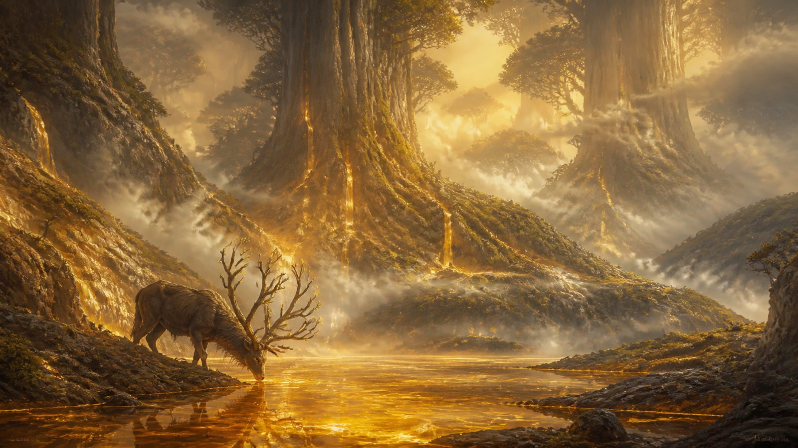

| Field | Detail |
|---|---|
| Landforms | Root-hills 15–40 m high, formed by single roots arching out of the ground; amber lakes 50–300 m across in the hollows between them; trunks 30–60 m wide that vanish into mist |
| Ground | Living ground only. Dark loam, moss 10 cm deep, fallen bark plates the size of doors. No Blight can hold here (Spec: no infected creature survives long) |
| Light | Gold-green. Key light warm (#E8C77A), fill soft green (#7D9468), mist always present at 20–40% density. No hard shadows |
| Weather | **Sap rain:** a fine golden drizzle at dawn when the trees exhale. Purely cosmetic |
| Deep past | The planet's first awareness woke here, under the First Root. The root-hills are its oldest thoughts, grown into wood |
| Old wound | None. The Heartwood has never been touched, which is why it matters |
| Now | Wildborn pilgrims carry Heartwood seeds to every match map as groves (`gdd/10`). Seen as small planted circles of stones around young trees |
| Food web | Mossback Grazers and the Heartwood Elk graze the lake shores; Sapback Aphids farm the trunks; Rootwalkers guard the groves. No predators hunt here: they stop at the edge |
| Sound bed | A low hum (planet awareness) under slow wind and dripping sap. **Signature:** the Elk's single low horn |
| Set dressing | Root arch (15–40 m), amber lake edge with sap crust, Heartwood giant trunk (30–60 m wide), door-sized bark plate, pilgrim stone circle (6 m), Heartbloom clumps |
| Map notes | Not a match map. Use it for menus, story Memories and every map's Heartwood grove. A grove should borrow three things: a root arch, a sap pool, gold mist |

## 12.2 Rootwilds (lungs)

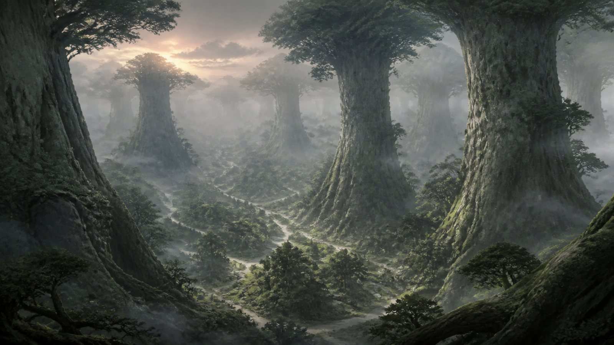

| Field | Detail |
|---|---|
| Landforms | Gentle valleys 200–600 m wide; trunks 6–12 m wide every 15–25 m; clearings 20–40 m across where old trees fell |
| Ground | Leaf litter, ferns, Tanglewort mats. Fallen trunks 2–4 m high make natural walls |
| Light | Grey-green, dappled. Canopy blocks 70% of the sky. God-rays only at dawn |
| Weather | **The breath:** every 90 s the canopy rises and falls 1–2 m and pushes out a mist wave along the ground (cosmetic; 3 s lower visibility at ground level) |
| Deep past | The planet grew the Rootwilds to breathe for it. The valleys follow old root lines; walking the valley floor is walking along a buried root |
| Old wound | A great fire, three Kith generations ago, left **Charline Rings**: circles of black stumps inside green forest, now full of young growth and Sapbloom |
| Now | Weavemother webs spread between trunks. Blight arrives in pockets through the Underroot and appears as glass patches on fallen trunks |
| Food web | Glimmerfoxes hunt Rootworms; Weavemothers catch Strider Cranes that wander in; Sapdrinkers drain the trees; Threadlings clean up the bodies |
| Sound bed | Birdsong, creaking wood, wind in leaves. **Signature:** the slow breath of the canopy, like a giant sleeping |
| Set dressing | Breathing Oak (6–12 m trunk), fallen trunk wall (2–4 m high, 20 m long), Charline Ring (25 m), web curtain (8 × 6 m), fern bank, Seedburst Pine |
| Map notes | Short sightlines (25–40 m). Many small nodes. Fallen trunks are the main cover; keep at least two routes around every web |

## 12.3 Underroot (nerves)

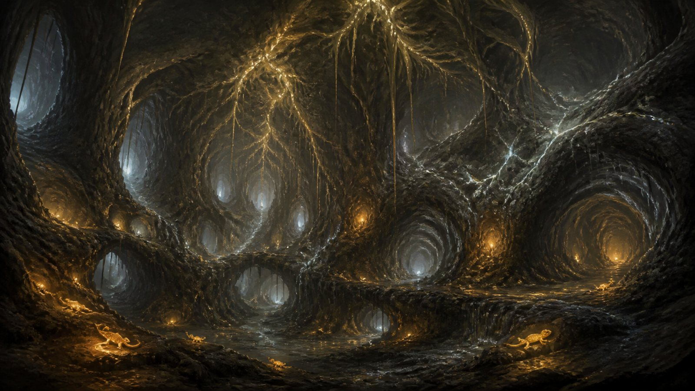

| Field | Detail |
|---|---|
| Landforms | Tunnels 4–12 m wide; chambers 30–80 m across; nerve trunks (glowing roots) 1–3 m thick running along walls and ceilings |
| Ground | Wet stone, root mats, mineral pools. Blight here is thin glass veins in the rock |
| Light | Near black. Light sources only: nerve pulses (pale cyan-white, #CFE8F0), Lantern Lizards (amber), Root-lamps (green-gold) |
| Weather | **Nerve pulses:** a wave of light travels along the walls every 20 s; anyone on a wall it passes is briefly lit (ties into The Nerve map, `gdd/30`) |
| Deep past | The planet's nervous system. Every region is connected here, which is why sound and light travel strangely |
| Old wound | **Cut nerves:** dead, grey roots where an old cave-in severed a trunk. Nothing glows there, and creatures avoid them |
| Now | The Murmur's fastest road. Glass veins follow the dead nerves first, because nothing fights back there |
| Food web | Lantern Lizards eat cave insects; Glasslegs eat Lantern Lizards; Burrowtusks dig between surface and caves; the Eightfold Matron rules the deepest chambers |
| Sound bed | Dripping water, distant echoes that come from the wrong direction. **Signature:** a deep thrum each time a nerve pulse passes |
| Set dressing | Nerve trunk (1–3 m), Root-lamp bulb (0.5 m), mineral pool (3–10 m), cave-in rubble field, dead-nerve section, stalactite clusters. **New ambient plant (Proposal): Ghostcap**, pale mushrooms that glow faintly only after a nerve pulse passes |
| Map notes | Use as flanking tunnels under surface maps. Every tunnel needs a lit landmark at each end so players know where they'll come out |

## 12.4 Ashen Steppe (skin)

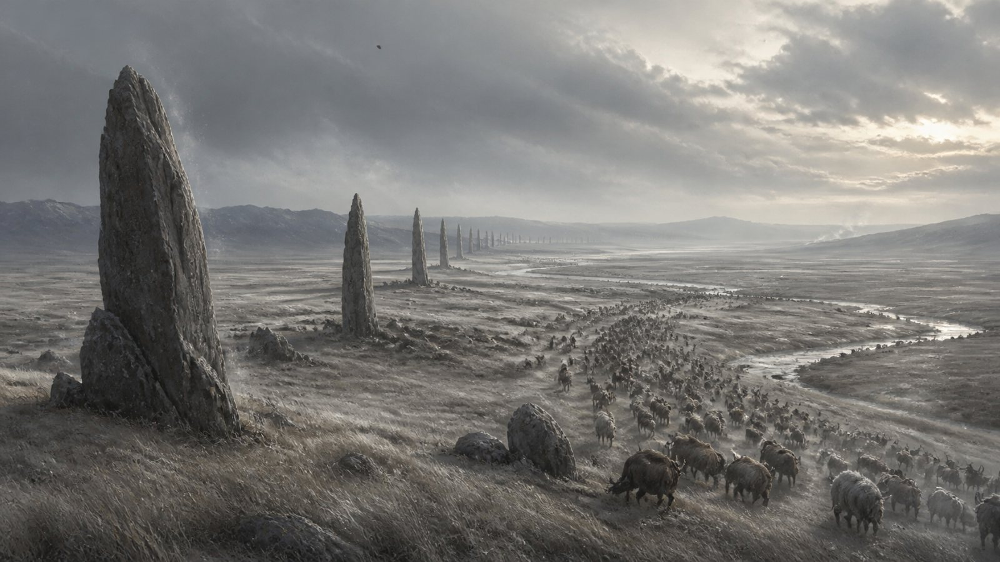

| Field | Detail |
|---|---|
| Landforms | Rolling plains with 3–8 m swells; dry riverbeds 10–30 m wide; the Standing Stones, 12–20 m tall, in a line every 400 m |
| Ground | Ashgrass (knee height, grey-gold), cracked dry earth, ash drifts in hollows |
| Light | Pale and flat. Sky #C9C6BC, ground #8F8A7A. Long shadows at dusk |
| Weather | **Ashfall:** fine ash always drifting. Ashfall storms drop visibility to 40 m (Spec hazard) |
| Deep past | The skin of the planet. The Standing Stones are scales of an older surface, pushed up when the land shrugged |
| Old wound | **The Grey Migration** wore permanent trails, 20 m wide, across the steppe. Each herd follows the same lines; nodes near the trails are fought over |
| Now | Ashfangs follow the herds. Blight appears along the north end of the Stone line, where the Starwound is closest |
| Food web | Mossback Grazers and Sixhorn Rams graze; Ashfang packs hunt the stragglers; Ash Vultures follow; Gravel Skinks and Spurlarks live in the grass; the Greyback Colossus walks through all of it |
| Sound bed | Constant wind, grass hiss, far-off herd calls. **Signature:** the ground rumble of the migration, felt before it's seen |
| Set dressing | Standing Stone (12–20 m), migration trail decal (20 m wide), dry riverbed, Bellows Gourd, ash drift, bleached horn piles |
| Map notes | Long sightlines (80–150 m). Ashfall Crossing lives here. Swells should be just tall enough to hide a Stage 2 Ascendant (4 m) |

## 12.5 Hollow Mire (gut)

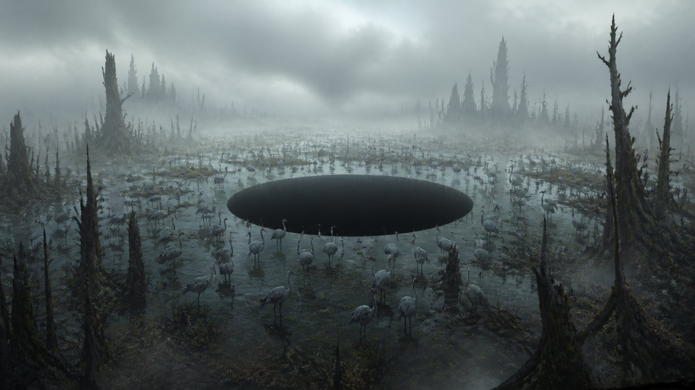

| Field | Detail |
|---|---|
| Landforms | Shallow water 0.3–1 m deep; mud islands 10–30 m across; drowned trees; the Swallowing Pool, 40 m across, perfectly round |
| Ground | Deep mud (Spec: −20% speed), reed beds, Weepwillow roots that form walkways 2 m wide |
| Light | Grey and soft. Fog 50–70%. Sky barely visible. Colour drains toward the pool |
| Weather | **Sound damping:** sounds carry half as far (Spec hazard). Fog banks roll in for 30 s at a time |
| Deep past | The gut: everything that dies flows here to be broken down and returned to the roots |
| Old wound | **The Sunk Herd:** antlers and spines of a whole drowned migration stick out of the water near the pool |
| Now | Hexmaws have grown bolder. Hollowmonks gather at the pool's edge and stand still for hours |
| Food web | Strider Cranes eat fish; Hexmaws and Tendril Crawlers eat cranes; Mire Scuttlers eat what's left; Duskmanes hunt the islands |
| Sound bed | Dripping, frogs, insect hum, all muffled. **Signature:** the Hush Cicada going silent all at once |
| Set dressing | Weepwillow walkway, drowned tree (8–15 m), reed bed, Sunk Herd antler field, Mirrorleaf, mud island |
| Map notes | Stealth and ambush. Every mud island needs two exits. Mark Hexmaw water with bubbles 3 s before a grab |

## 12.6 Spirecliffs (spine)

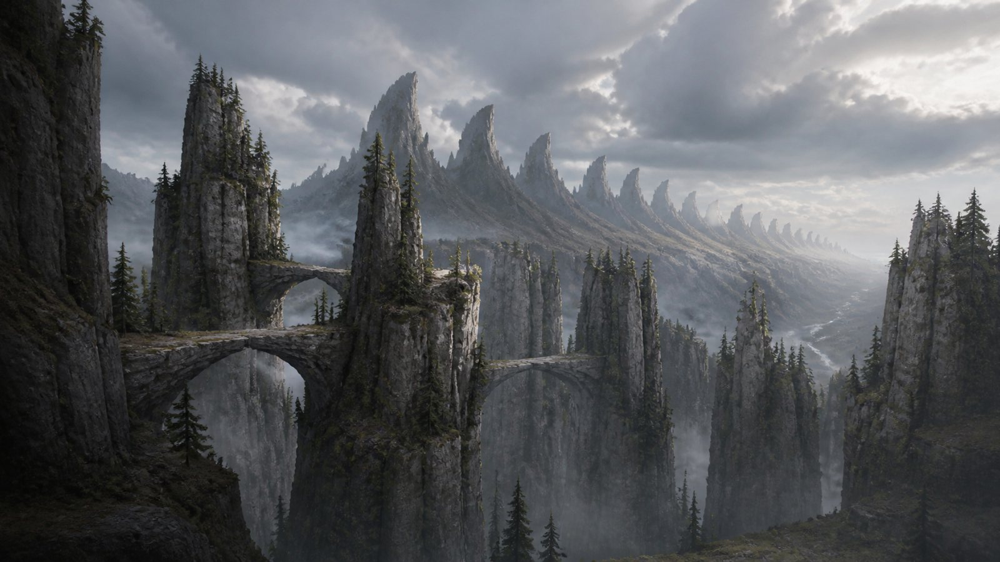

| Field | Detail |
|---|---|
| Landforms | Rock columns 40–200 m tall; ledges 3–10 m deep; natural stone bridges 30–80 m long; the Vertebrae on the horizon |
| Ground | Bare grey stone, lichen, scree slopes, Sky Pines on ledges |
| Light | Clear and cold. Strong sun, deep blue-grey shadows (#4E5A6B). Clouds below some ledges |
| Weather | **Gusts:** a 3 s wind every 40 s pushes everyone 2 m toward the drop side (Spec hazard: wind) |
| Deep past | The planet's spine broke the surface when the Greyreach formed. The Vertebrae line up north–south exactly |
| Old wound | **Fallen spires:** columns that cracked and fell across valleys now serve as bridges; their broken stumps are flat-topped lookouts |
| Now | Knucklebrutes hold the lookouts. Thornwasp nests hang under the bridges |
| Food web | Sixhorn Rams and Stonehide Oxen graze the ledges; Knucklebrutes eat roots and fight everything; Thornwasps eat carrion; Rimeback Stags come down in cold Turns |
| Sound bed | Howling wind, falling pebbles. **Signature:** Echo Bells ringing as the gusts hit them |
| Set dressing | Rock column (40–200 m), fallen-spire bridge, flat lookout stump, scree slope, Sky Pine, Echo Bell cluster |
| Map notes | Vertical play. Each drop needs a visible edge decal; every ledge needs a way back up within 10 s |

## 12.7 Bone Flats (memory)

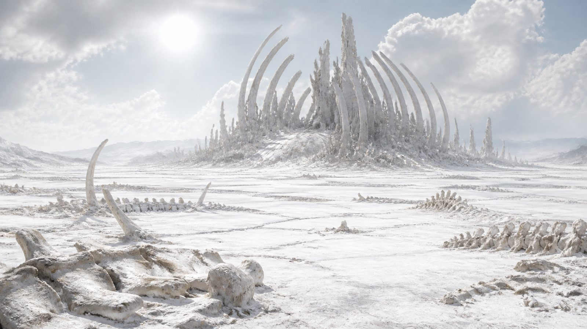

| Field | Detail |
|---|---|
| Landforms | Dead-flat salt plain; fossil ribs, skulls and spines 5–60 m tall; the Elder Ribs (a ribcage the size of a city) |
| Ground | White salt crust, Saltcrust Lichen (loud underfoot), bone fields that slow movement (Spec hazard) |
| Light | Overexposed at noon (Spec: salt glare), cool white. Morning and dusk are the readable hours |
| Weather | **Salt devils:** small whirlwinds 3–5 m tall wander the plain; cosmetic, but they reveal footprints |
| Deep past | The planet remembers every creature that lived. The fossils are memories, pushed up as bone |
| Old wound | **The Picked Field:** fossils already copied by the Murmur, now hollow and glass-lined |
| Now | The Murmur hunts here for bones to copy. Blight runs along fossils like frost along a branch |
| Food web | Bone Harvestmen gather bones; Marrowhounds eat marrow and cores; Marrow Mantises hunt from the ribs; Siege Beetles and Trundlebacks graze lichen |
| Sound bed | Salt crunch, wind whistling through bones. **Signature:** the wind making a low organ note in the Elder Ribs |
| Set dressing | Fossil rib (5–60 m), half-buried skull, salt crust plate, Harvestman bone nest, Bone Thistle, glass-lined hollow fossil |
| Map notes | Open plain with bone clusters as cover. Use bones to break every sightline longer than 120 m |

## 12.8 Rimewastes (sleep)

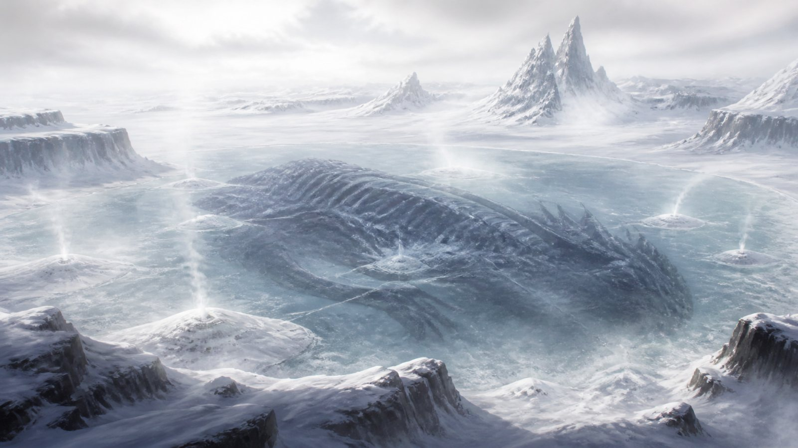

| Field | Detail |
|---|---|
| Landforms | Frozen plateau; the frozen lake over The Sleeper (2 km across); round drifts 3–6 m high (some are Owlbears); ice caves |
| Ground | Snow, wind-polished ice, thin ice over deep water (Spec hazard), Frost Fern beds |
| Light | Low white sky, very little shadow. Blue undertones (#B8C6D4). Colour comes only from creatures and glow |
| Weather | **Whiteout:** 20 s of near-zero visibility (Spec hazard). Frost plumes rise from drifts with something sleeping inside |
| Deep past | The planet sleeps here to dream. Life slows; creatures hibernate for whole Turns |
| Old wound | The Sleeper itself: something enormous froze under the lake long ago. Its heartbeat can be heard through the ice |
| Now | Frost-Blight has started to appear: thin violet lines in the ice that spread overnight |
| Food web | Rimeback Stags dig for Frost Fern; Drift Owlbears sleep in drifts and wake for anything close; Hoarfrost Mites live in frost patches; Stiltwalkers cross in the Rime Turn |
| Sound bed | Near silence, ice creaks. **Signature:** the Sleeper's heartbeat under the ice, every 6 s |
| Set dressing | Round drift (3–6 m), frost plume, ice cave mouth, frozen lake crack, Frost Fern, Driftcotton |
| Map notes | Slow fights, slippery ground. Breakable ice floors must crack visibly 1.5 s before they break |

## 12.9 Cinderveil (fever)

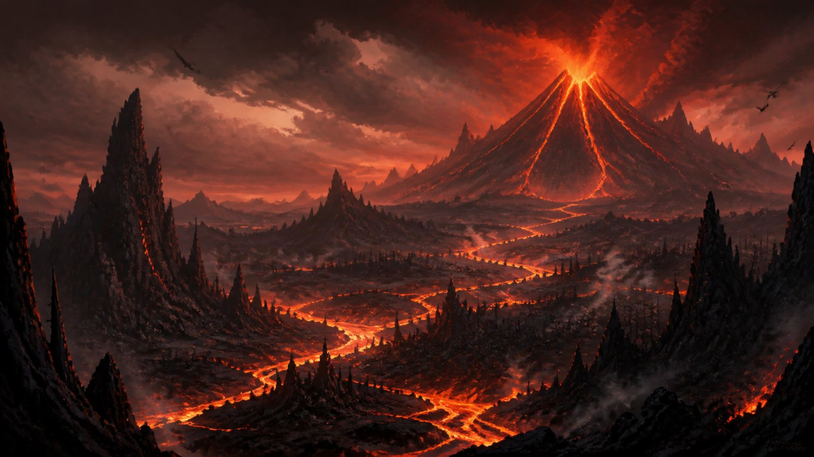

| Field | Detail |
|---|---|
| Landforms | Volcanic highlands, lava rivers 5–20 m wide, black basalt ridges, burnt forests; the Fevermouth volcano on the horizon |
| Ground | Black basalt, cooled lava crust, ash, burnt stumps, Embergrass |
| Light | Red from below (#C2452D), black shadows, heat haze over the lava |
| Weather | **Eruptions on a timer** (Spec hazard). Cinderroot glows red 3 s before a vent bursts |
| Deep past | The planet ran a fever to burn out the infection; the meteorite's heat woke old volcanoes |
| Old wound | **The Melted Line:** a band of half-melted glass where Blight met lava. Both sides suffer here |
| Now | The Fevermouth erupts whenever Blight comes too close; the fight follows the eruption cycle |
| Food web | Cinder Salamanders swim lava; Ember Moths swarm the heat; Ash Vultures circle every fight; heat-adapted Ashfangs and Siege Beetles move between cool ridges |
| Sound bed | Rumbling ground, crackling fire, hissing steam. **Signature:** the Fevermouth's slow, rising groan before it erupts |
| Set dressing | Lava river edge, basalt column, burnt tree, Cinderroot vent, half-melted glass band, ash drift |
| Map notes | Fast, dangerous, timed. Every lava edge needs a 1 m cooled lip so players don't fall in by accident |

## 12.10 Shattered Coast (wound edge)

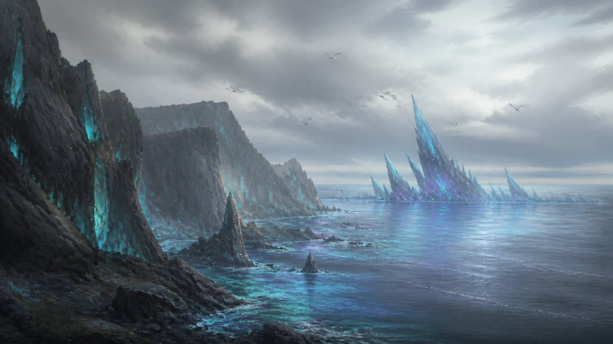

| Field | Detail |
|---|---|
| Landforms | Grey sea cliffs 30–80 m tall, shard-studded; pebble beaches; tide pools; the Shard Reef offshore |
| Ground | Wet pebbles, kelp, tide pools, meteor-glass shards from 0.2 to 6 m |
| Light | Overcast grey, cyan-violet glitter in the water near shore (#6FD3E0 / #9A7BD6) |
| Weather | **Shard storms** and **tidal surges** (Spec hazards). The reef sings when the wind passes through it |
| Deep past | Meteor fragments fell into the sea here as the Starwound struck |
| Old wound | **The Drowned Cliff:** a whole cliff face slid into the sea under the weight of glass, leaving a fresh pale scar |
| Now | Half-blighted from the start. A front line. Stillsong Whales sing from offshore, holding the Blight back |
| Food web | Shard Gulls nest on the cliffs; Tidecrawlers and Mire Scuttlers work the tideline; Tidal Striders wade the shallows; the Deepmaw rises at night |
| Sound bed | Surf, gulls, wind. **Signature:** whale song coming up through the rock |
| Set dressing | Shard-studded cliff, tide pool, Kelpwhip bed, Shard Gull nest, glass reef spire. **New ambient plant (Proposal): Saltglass Kelp**, kelp with tiny glass beads that tinkle in the surf |
| Map notes | Shard Reef lives here. The tide line moves; show the next tide with wet sand 10 s ahead |

## 12.11 Glasswaste (scar tissue)

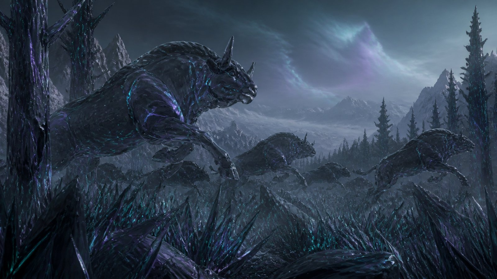

| Field | Detail |
|---|---|
| Landforms | A former forest and steppe turned to black glass: frozen trees, the Frozen Herd, glass dunes |
| Ground | Black meteor glass (#141821, roughness 0.08), glass grass that chimes, sharp ground (Spec hazard) |
| Light | Cold and dim; cyan-violet veins are the main light source |
| Weather | **Whispering:** constant; reveals positions (Spec hazard) |
| Deep past | This was Rootwilds and Steppe, not long ago |
| Old wound | **The Frozen Herd:** a whole migration caught mid-gallop, the clearest picture of what the war is about |
| Now | Blightborn home ground. In Season 5, pale blue gardens grow here (`gdd/47`) |
| Food web | Broken. Only Blighted creatures: they don't eat, they move in sync and copy |
| Sound bed | Whispers and the chime of glass grass. **Signature:** silence where birdsong should be |
| Set dressing | Glass tree, Frozen Herd statue, glass grass field, glass dune, Glasscap |
| Map notes | Every map's Starwound crater zone draws from here. Keep 20–30% organic shapes visible so players recognise what was lost |

## 12.12 The Starwound (the wound itself)

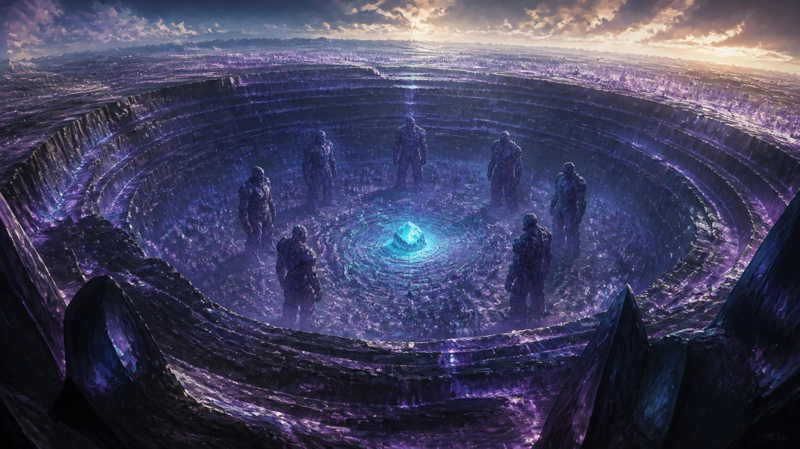

| Field | Detail |
|---|---|
| Landforms | Crater miles wide; terraced glass walls; the ring of six Hushed Answers on the floor; a sea of crystal spires; the Seed at the centre |
| Ground | Pure meteor glass, crystal spires 10–80 m tall |
| Light | Cyan core glow from the Seed, violet everywhere else |
| Weather | **The Murmur's thought:** a slow ripple of light crosses the crater every minute |
| Deep past | The meteorite struck the far north |
| Old wound | Everything here is the wound |
| Now | The Murmur's stronghold; the Hushed Watch endgame mode (Part 6) |
| Food web | None |
| Sound bed | A single deep tone from each of the six Hushed Answers, layered. **Signature:** the Seed's pulse |
| Set dressing | Glass terrace, crystal spire, Hushed Answer statue, the Seed |
| Map notes | Not a standard match map. Story moments, events and the endgame |

---

## 12.13 How the regions meet (transition kits)

Match maps often sit where two regions meet. These transitions keep the
change readable:

| From → to | Transition band | What changes first |
|---|---|---|
| Rootwilds → Hollow Mire | 60–100 m | Trees thin; ground gets wet before the fog arrives |
| Rootwilds → Ashen Steppe | 80–150 m | Canopy breaks into isolated trees; grass turns grey-gold |
| Ashen Steppe → Spirecliffs | 40–80 m | Standing Stones get taller and closer until they become columns |
| Ashen Steppe → Bone Flats | 100–200 m | Grass gives way to salt; bones appear before the salt is white |
| Spirecliffs → Rimewastes | 60 m | Snow on ledges first, then on the ground |
| Cinderveil → Glasswaste | 30–60 m | The Melted Line: half-melted glass, steam |
| Shattered Coast → Glasswaste | 40 m | Shards grow from pebble size to boulder size |
| Any surface → Underroot | Cave mouth | A lit landmark at the mouth; nerve glow visible from outside |

## 12.14 About the AI-generated art

The images in `img/regions/` and `img/bestiary/` were made with AI image models
(Google Gemini through Figma, and Canva's image generator) from the prompts in
`tools/art_prompts.py`. They are **concept references**, not final art:

- Use them for mood, palette and silhouette. Sizes and numbers in this document win.
- Known drift: some six-legged creatures came out with four legs; Spec counts win.
- To redo one, edit its prompt in `tools/art_prompts.py`, regenerate and keep the same file name.
- Part 13 (`13-bestiary-gallery.md`) shows every creature image and which tool made it. `tools/canva_media.tsv` maps the Canva-made images to their Canva media IDs.
